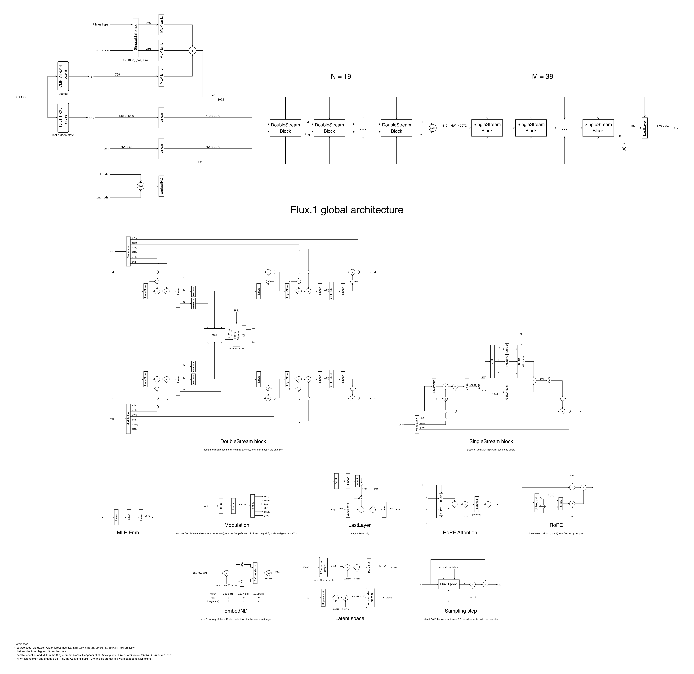

# Flux.1-Architecture-Diagram
A detailed diagram laying out the full Flux.1 [dev] architecture as shared by Black Forest Labs, broken down to single ML blocks.


(open the file to view it zoomed in, or use the [PDF](./diagram/flux_architecture_diagram.pdf))

The diagram is written in [Typst](https://typst.app) with [CeTZ](https://github.com/cetz-package/cetz), every figure has its own file in `diagram/`. To rebuild it:
```sh
typst compile diagram/flux_architecture_diagram.typ flux_architecture_diagram.png --ppi 200
```
The first draft made with draw.io is still in `flux_architecture_diagram.drawio`.

# A few things worth noticing
- the 19 DoubleStream blocks keep separate weights for the text and the image, the two streams only meet inside the attention. After them the tokens are concatenated (text first) and go through 38 SingleStream blocks
- the SingleStream blocks run attention and MLP in parallel out of one fused Linear, then merge both with a second Linear
- `vec` is the sum of three MLP embeddings (timestep, guidance and the pooled CLIP vector), every block computes its own modulation from it with a SiLU then a Linear
- the guidance is distilled into an embedding, so each sampling step is a single forward pass with no CFG
- the T5 prompt is always padded to 512 tokens and the padding is never masked
- RoPE has 3 axes (16, 56 and 56 dims) and rotates interleaved pairs of dimensions, all the text tokens sit at position 0 and the first axis is only used by Kontext
- the latent has 16 channels, it is shifted (0.1159) and scaled (0.3611) then packed 2×2 into 64 channel tokens
- the sampling schedule is shifted toward high noise, more so for larger images

# References
- [Flux.1 source code](https://github.com/black-forest-labs/flux)
- [@nrehiew original diagram](https://x.com/nrehiew_/status/1820404554795802684) (latter [reposted on Reddit](https://www.reddit.com/r/LocalLLaMA/comments/1ekr7ji/fluxs_architecture_diagram_dont_think_theres_a/) by u/pppodong)
- Tensor shapes calculations: [Pytorch documentation](https://pytorch.org/docs/stable/index.html)
- Original paper that inspired the SingleStream blocks: [Dehghani et al., *Scaling Vision Transformers to 22 Billion Parameters*, 2023](https://arxiv.org/abs/2302.05442)
